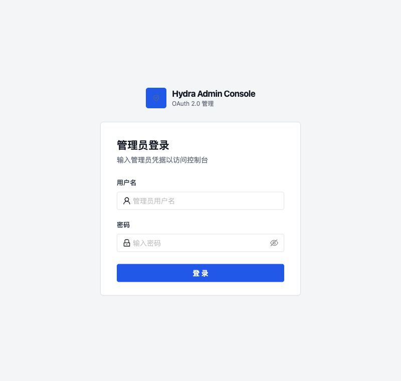
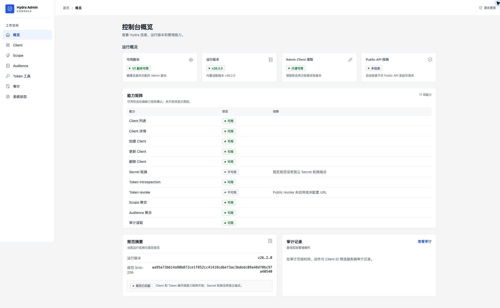
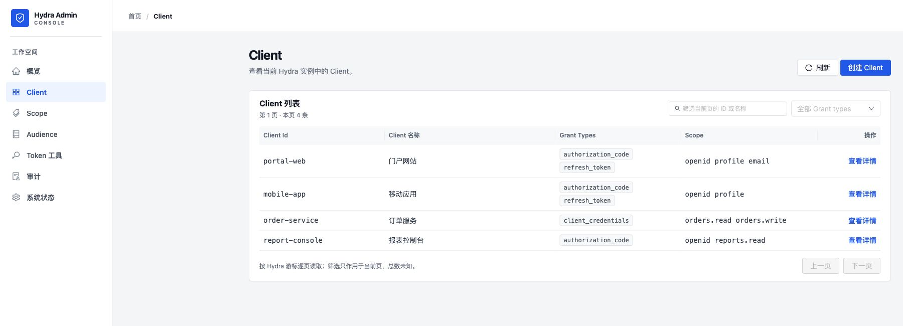
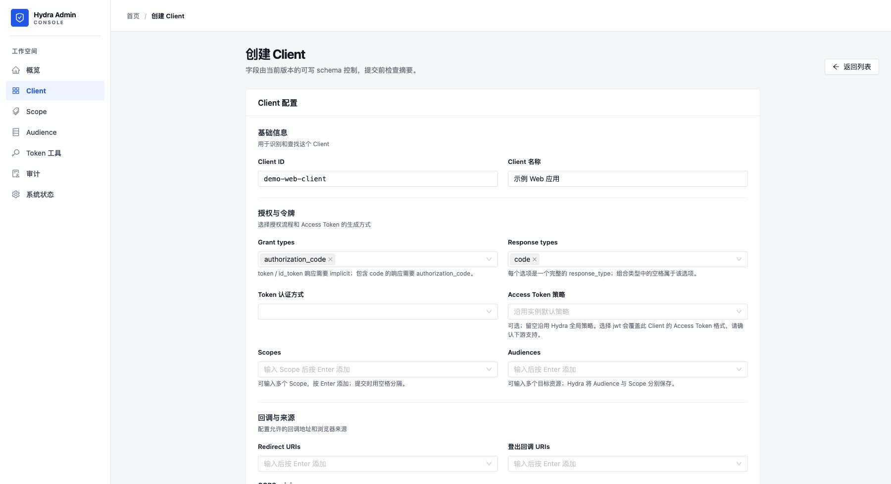

# Hydra Admin Console

Go + React 管理台，用于管理受支持的 ORY Hydra Client，并查看 Scope、Audience、Token 和审计信息。多个共用数据库、issuer 与密钥的 Hydra 副本可配置为一个逻辑部署。当前固定支持 Hydra `v26.2.0`；运行版本不匹配时会关闭 Client 和 Token 业务操作。

## 目录

- [功能与当前限制](#功能与当前限制)
- [快速开始](#快速开始)
- [界面预览](#界面预览)
- [直接下载二进制包](#直接下载二进制包)
- [命令与配置](#命令与配置)
- [访问方式](#访问方式)
- [Linux systemd 后台运行](#linux-systemd-后台运行)
- [升级回滚与卸载](#升级回滚与卸载)
- [从源码构建](#从源码构建开发)
- [验证与发布](#验证与发布)
- [排错](#排错)

## 功能与当前限制

可管理 Client，查看从 Client 聚合的 Scope 和 Audience，按已确认能力使用 Token 内省/吊销，并按时间、动作、Client ID 查看审计记录。支持多个共用 Hydra 数据的 Admin 副本及各副本状态展示。可配置 Audience 与 Scope 预设、登录锁定、会话时长、API 限流和日志/审计轮转；完整字段及默认值见 [示例配置](configs/config.example.yaml)。

- Client 列表使用 Hydra 游标分页，每页 10 条；Scope / Audience 仅聚合当前可读取的前 100 个 Client，结果可能不完整。
- 替换式 PUT 和 Secret 轮换关闭；Token 操作按版本探测及配置显示。
- Hydra 版本不匹配时，Client / Token 操作关闭；登录、状态、诊断和本地审计仍可用。详见 [支持版本与能力](SUPPORTED_HYDRA_VERSIONS.md)。

## 快速开始

1. 从 [最新 Release](https://github.com/FutureHai/hydra-admin/releases/latest) 下载对应系统的压缩包和同名 `.sha256`，按[下文](#直接下载二进制包)校验并解压。
2. 在交互终端运行 `./hydra-admin hash-password`（Windows 用 `.\hydra-admin.exe`），将输出写入 `config.yaml` 的 `auth.password_hash`。
3. 设置 `server.public_base_url`、`hydra.admin_replicas` 中的 Admin 地址，并按[访问方式](#访问方式)检查监听、Cookie 与代理配置。
4. 保护配置文件，在解压目录运行 `./hydra-admin check --config ./config.yaml`，再运行 `./hydra-admin serve --config ./config.yaml`。
5. 在浏览器打开 `server.public_base_url`。Windows 将上述启动命令中的 `./hydra-admin` 换成 `.\hydra-admin.exe`。

`check` 不向 Hydra 发写请求，但会在本地创建日志/审计目录、创建并删除临时探针文件，并检查已有文件的写权限。相关路径需要可写；只读挂载且没有可写目录时会失败。

## 界面预览

以下截图使用本地测试数据；实际可用操作以连接的 Hydra 版本和能力检测结果为准。点击图片可查看原图。

| 管理员登录 | 控制台概览 | Client 列表 | 创建 Client |
| :---: | :---: | :---: | :---: |
| <a href=".github/screenshots/login.jpg"></a> | <a href=".github/screenshots/overview.jpg"></a> | <a href=".github/screenshots/clients.jpg"></a> | <a href=".github/screenshots/create-client.jpg"></a> |

## 直接下载二进制包

无需安装 Go、Node.js 或 npm。打开 [最新 Release](https://github.com/FutureHai/hydra-admin/releases/latest) 或 [全部版本](https://github.com/FutureHai/hydra-admin/releases)，在 **Assets** 中下载与你的系统和 CPU 匹配的压缩包及同名 `.sha256` 文件。发布包内已有网页、示例 `config.yaml` 和许可证材料；只下载可执行文件会缺少配置模板。

| 系统 | CPU | 附件名称中的目标 | 解压格式 |
| --- | --- | --- | --- |
| Linux | x86_64 / aarch64 | `linux-amd64` / `linux-arm64` | tar.gz |
| macOS | Intel / Apple 芯片 | `darwin-amd64` / `darwin-arm64` | tar.gz |
| Windows | x64 / ARM64 | `windows-amd64` / `windows-arm64` | zip |

发布流程为上述六种目标生成压缩包，命名为 `hydra-admin-v<版本>-<目标>.tar.gz` 或 `.zip`。先在 Release 页面确认附件完整；以下示例中的 `X.Y.Z` 改为所下载版本号，并按 CPU 架构选择 `amd64` 或 `arm64`。同名 `.sha256` 校验压缩包，包内 `SHA256SUMS` 校验解压文件。

### Linux

在下载目录中执行；`x86_64` 选 `amd64`，`aarch64` 选 `arm64`：

```bash
VERSION=X.Y.Z  # 改成 Assets 中已发布的版本
ARCH=amd64     # ARM64 机器改成 arm64
PACKAGE="hydra-admin-v${VERSION}-linux-${ARCH}"
sha256sum -c "${PACKAGE}.tar.gz.sha256"
tar -xzf "${PACKAGE}.tar.gz"
cd "${PACKAGE}"
sha256sum -c SHA256SUMS
./hydra-admin version
```

### macOS

在下载目录中执行；Apple 芯片选 `arm64`，Intel 选 `amd64`：

```bash
VERSION=X.Y.Z  # 改成 Assets 中有 macOS 附件的版本
ARCH=arm64     # Intel Mac 改成 amd64
PACKAGE="hydra-admin-v${VERSION}-darwin-${ARCH}"
shasum -a 256 -c "${PACKAGE}.tar.gz.sha256"
tar -xzf "${PACKAGE}.tar.gz"
cd "${PACKAGE}"
shasum -a 256 -c SHA256SUMS
./hydra-admin version
```

### Windows

在下载目录打开 PowerShell，按机器架构修改 `$arch`。以下示例先校验压缩包，再解压并逐项核对 `SHA256SUMS`：

<details>
<summary>展开 PowerShell 校验与解压命令</summary>

```powershell
$version = 'X.Y.Z' # 改成 Assets 中有 Windows zip 的版本
$arch = 'amd64'    # ARM64 机器改成 arm64
$package = "hydra-admin-v${version}-windows-${arch}"
$archive = "${package}.zip"
$expected = ((Get-Content "${archive}.sha256" -Raw) -split '\s+')[0]
if ((Get-FileHash $archive -Algorithm SHA256).Hash -ne $expected) { throw '压缩包校验失败' }
Expand-Archive -Path $archive -DestinationPath .
Set-Location $package
Get-Content SHA256SUMS | ForEach-Object {
  if ($_ -notmatch '^([0-9a-f]{64})  (.+)$') { throw '包内校验文件格式错误' }
  $hash = $Matches[1]
  $path = $Matches[2]
  if ((Get-FileHash $path -Algorithm SHA256).Hash -ne $hash) { throw "文件校验失败: $path" }
}
.\hydra-admin.exe version
```

</details>

## 命令与配置

| 命令 | 用途 |
| --- | --- |
| `version` | 输出程序版本、提交、构建时间及 Go 版本。 |
| `hash-password [--algorithm bcrypt]` | 在交互式 TTY 静默读取两次密码并输出哈希；默认 Argon2id，也接受 `--algorithm argon2id`。需 bcrypt 时指定 `--algorithm bcrypt`。无 TTY 会报错并退出 1。 |
| `check --config <路径>` | 校验配置和本地写入路径，执行 Hydra 只读版本/健康/Client 列表探测并输出能力报告。 |
| `serve --config <路径>` | 启动管理台；不带子命令时默认执行 `serve`。 |

`check` 和 `serve` 必须提供 `--config`；命令或参数不正确时退出码为 2。`check` 校验或探测失败时退出码为 1；探测完成时仍会输出 JSON 能力报告。成功时退出码为 0。`serve` 持续运行到服务停止，运行错误返回 1。

### 配置并启动

在**解压后的包目录**先生成密码哈希，再编辑 `config.yaml`。至少设置 `server.public_base_url`（浏览器访问管理台的根地址）、`hydra.admin_replicas` 中的 Admin 地址和 `auth.password_hash`。`hash-password` 会在交互终端静默读取两次密码；把输出的哈希填入配置，示例哈希不能登录。程序根据浏览器地址、监听 IP 和可信代理自动判断访问方式；非回环 HTTP 只需显式设置 `security.allow_insecure_http: true`。Hydra Admin 副本可配置管理台机器能够直接访问的 HTTP/HTTPS 地址，支持 IP 或域名；这里的 HTTP 不需要设置 `security.allow_insecure_http`，该开关只控制浏览器访问管理台。`hydra.public_api_base_url` 若用于 revoke，跨主机访问仍需 HTTPS。

```bash
chmod 600 config.yaml
./hydra-admin hash-password
# 如需 bcrypt：./hydra-admin hash-password --algorithm bcrypt
```

编辑并保存 `config.yaml` 后，在同一目录执行：

```bash
./hydra-admin check --config ./config.yaml
./hydra-admin serve --config ./config.yaml
```

Windows 在 PowerShell 中运行 `.\hydra-admin.exe hash-password`，把哈希写入 `config.yaml` 并限制该文件的访问权限，再执行 `.\hydra-admin.exe check --config .\config.yaml` 和 `.\hydra-admin.exe serve --config .\config.yaml`。成功后，在浏览器打开 `server.public_base_url`。

常用配置：`auth.session_ttl` 控制会话有效期；`auth.login` 控制登录失败次数与锁定时长；`security.api_rate_limit` 控制读取和写入请求的每 IP 速率；`audit` / `log` 控制文件大小、保留归档数和权限。可选的 `resource_catalog` 为 Audience 设置可选 Scope。当前示例值和全部字段以 [config.example.yaml](configs/config.example.yaml) 为准。

`GET /healthz` 无需登录，成功时返回 HTTP 200 和 `{"status":"ok"}`；可用于服务存活探针，它不代表 Hydra 就绪或版本受支持。Hydra 状态及禁用原因请看管理台状态页或 `check` 报告。

## 访问方式

访问方式共用同一组配置字段：

| 浏览器访问方式 | `bind_address` | `public_base_url` | `trusted_proxy_cidrs` | `cookie_secure` | `allow_insecure_http` |
| --- | --- | --- | --- | --- | --- |
| 本机回环 HTTP | `127.0.0.1` | `http://127.0.0.1:8085` | `[]` | `false` | `false` |
| 单机内网 IP 直连 | 管理台私有 IP | `http://同一私有IP:8085` | `[]` | `false` | `true` |
| 跨服务器 HTTP 代理 | 管理台内网 IP | `http://浏览器访问域名` | 代理源 IP `/32` | `false` | `true` |
| HTTPS 代理 | 管理台内网 IP | `https://浏览器访问域名` | 代理源 IP CIDR | `true` | `false` |

HTTP 直连时不能信任远程代理 CIDR；回环监听地址也不能配置远程可信代理。跨服务器 HTTP 代理需要将直接连接到管理台的每台远端代理列为单 IP CIDR（IPv4 `/32`、IPv6 `/128`）。

HTTP 会明文传输登录密码和会话 Cookie，应仅在受控网络使用。完成任一种模式的配置后，运行 `./hydra-admin check --config ./config.yaml` 验证；它还要求日志与审计目录可写。

### 单机内网 IP 与端口直连

管理台和 Hydra 安装在同一台服务器，浏览器能直接访问管理台服务器的私有 IP 时，可在 `config.yaml` 中设置以下字段。示例中的 `10.0.0.12` 要替换为该服务器实际的内网 IP；访问地址中的 IP 和端口必须与监听地址及端口一致：

```yaml
server:
  bind_address: "10.0.0.12"
  port: 8085
  public_base_url: "http://10.0.0.12:8085"
  trusted_proxy_cidrs: []
security:
  cookie_secure: false
  allow_insecure_http: true
```

其余字段沿用示例配置。此模式仅接受私有 IP，不接受公网 IP、域名或不同端口；请用防火墙只允许需要访问管理台的内网网段连接 8085。

### 跨服务器 HTTP Nginx 代理

只有在浏览器最终访问地址确实为 HTTP 时，才开启此模式。以下示例中 `10.0.0.12` 是管理台服务器内网 IP，`10.0.0.11` 是 Nginx 连接管理台时的**实际源 IP**。在管理台服务器的 `config.yaml` 中设置：

```yaml
server:
  bind_address: "10.0.0.12"
  port: 8085
  public_base_url: "http://admin.example.com"
  trusted_proxy_cidrs:
    - "10.0.0.11/32"
security:
  cookie_secure: false
  allow_insecure_http: true
```

在 Nginx 服务器配置反向代理；其余 `config.yaml` 字段仍按示例文件填写：

```nginx
server {
    listen 80;
    server_name admin.example.com;

    location / {
        proxy_pass http://10.0.0.12:8085;
        proxy_set_header Host $host;
        proxy_set_header X-Forwarded-For $remote_addr;
        proxy_set_header X-Forwarded-Proto $scheme;
    }
}
```

此模式只接受 `trusted_proxy_cidrs` 中的直接连接来源；每台远端代理都要单独列出 `/32`（IPv6 为 `/128`），并用防火墙将 8085 端口限制为仅代理服务器可达。

### HTTPS Nginx 反向代理（推荐）

Nginx 与管理台在同一台服务器时，可由 Nginx 接收浏览器的 HTTPS 连接，再转发到本机回环地址。以下域名和证书路径需换成实际值。管理台 `config.yaml` 中设置：

```yaml
server:
  bind_address: "127.0.0.1"
  port: 8085
  public_base_url: "https://admin.example.com"
  trusted_proxy_cidrs:
    - "127.0.0.1/32"
security:
  cookie_secure: true
  allow_insecure_http: false
```

Nginx 示例：

```nginx
server {
    listen 80;
    server_name admin.example.com;
    return 301 https://$host$request_uri;
}

server {
    listen 443 ssl;
    server_name admin.example.com;
    ssl_certificate /etc/letsencrypt/live/admin.example.com/fullchain.pem;
    ssl_certificate_key /etc/letsencrypt/live/admin.example.com/privkey.pem;

    location / {
        proxy_pass http://127.0.0.1:8085;
        proxy_set_header Host $host;
        proxy_set_header X-Forwarded-For $remote_addr;
        proxy_set_header X-Forwarded-Proto https;
    }
}
```

Nginx 在其他服务器时，将 `bind_address` 改为管理台的可达内网 IP，并在 `trusted_proxy_cidrs` 中填写 Nginx 连接管理台时的实际源 IP；同时用防火墙仅允许代理访问管理台端口。若最外层代理负责 TLS 终止，仍须保证浏览器最终地址为 HTTPS、`public_base_url` 为该地址，并检查直接连接管理台的代理源 IP 与转发头。

## Linux systemd 后台运行

以下命令在**已解压并配置好的 Linux 发布包目录**执行，适用于使用 `systemd` 的发行版。先完成上面的密码、Hydra 地址和管理台 URL 配置，并确认 `./hydra-admin check --config ./config.yaml` 通过。示例把程序装在 `/opt/hydra-admin`，以专用用户运行；`audit.path` 和 `log.path` 保持示例配置中的 `./logs/...`。

```bash
if ! getent group hydra-admin >/dev/null 2>&1; then
  sudo groupadd --system hydra-admin
fi
if ! id hydra-admin >/dev/null 2>&1; then
  sudo useradd --system --gid hydra-admin --no-create-home --home-dir /opt/hydra-admin --shell /usr/sbin/nologin hydra-admin
fi
sudo install -d -m 0755 -o root -g root /opt/hydra-admin
if [ ./hydra-admin -ef /opt/hydra-admin/hydra-admin ]; then
  # 发布包已直接解压到 /opt/hydra-admin，无须复制文件到自身。
  sudo chown root:root ./hydra-admin
  sudo chmod 0755 ./hydra-admin
  sudo chown hydra-admin:hydra-admin ./config.yaml
  sudo chmod 0600 ./config.yaml
else
  sudo install -m 0755 -o root -g root ./hydra-admin /opt/hydra-admin/hydra-admin
  sudo install -m 0600 -o hydra-admin -g hydra-admin ./config.yaml /opt/hydra-admin/config.yaml
  sudo cp -R ./LICENSE ./SUPPORTED_HYDRA_VERSIONS.md ./THIRD_PARTY_NOTICES.md ./licenses /opt/hydra-admin/
fi
sudo install -d -m 0700 -o hydra-admin -g hydra-admin /opt/hydra-admin/logs
sudo -u hydra-admin sh -c 'cd /opt/hydra-admin && ./hydra-admin check --config ./config.yaml'
```

创建 `/etc/systemd/system/hydra-admin.service`：

```ini
[Unit]
Description=Hydra Admin Console
After=network-online.target
Wants=network-online.target

[Service]
Type=simple
User=hydra-admin
Group=hydra-admin
WorkingDirectory=/opt/hydra-admin
ExecStart=/opt/hydra-admin/hydra-admin serve --config /opt/hydra-admin/config.yaml
Restart=on-failure
RestartSec=5s
TimeoutStopSec=35s
NoNewPrivileges=true
PrivateTmp=true
ProtectHome=true
ProtectSystem=strict
ReadWritePaths=/opt/hydra-admin/logs
UMask=0077

[Install]
WantedBy=multi-user.target
```

`UMask=0077` 与配置中的 `audit.file_mode`、`log.file_mode: "0600"` 相容。若修改日志或审计文件路径，要同步调整 `ReadWritePaths` 和目录权限。保存服务文件后执行：

```bash
sudo systemd-analyze verify /etc/systemd/system/hydra-admin.service
sudo systemctl daemon-reload
sudo systemctl enable --now hydra-admin
sudo systemctl status hydra-admin --no-pager
curl -f http://127.0.0.1:8085/healthz  # bind_address 为内网 IP 时，改用该 IP
```

用 `sudo journalctl -u hydra-admin -n 100 --no-pager` 查看启动错误；应用日志和审计记录写入 `/opt/hydra-admin/logs/`。修改配置或更换二进制后运行 `sudo systemctl restart hydra-admin`。监听地址与浏览器入口按上面的访问方式配置；Hydra Admin API 应保持在受限网络内。

## 升级回滚与卸载

升级前从 [Release](https://github.com/FutureHai/hydra-admin/releases) 下载并校验新包，在**独立临时目录**解压，查看新版本说明及示例配置差异。保留现有 `config.yaml`、日志与审计文件，先备份当前二进制和配置，再停止服务、替换二进制并以服务用户运行 `check`：

```bash
sudo cp -p /opt/hydra-admin/hydra-admin /opt/hydra-admin/hydra-admin.previous
sudo cp -p /opt/hydra-admin/config.yaml /opt/hydra-admin/config.yaml.previous
sudo systemctl stop hydra-admin
# 当前目录应为新包的独立解压目录，不应是 /opt/hydra-admin
sudo install -m 0755 -o root -g root ./hydra-admin /opt/hydra-admin/hydra-admin
sudo -u hydra-admin sh -c 'cd /opt/hydra-admin && ./hydra-admin check --config ./config.yaml' && sudo systemctl start hydra-admin
sudo systemctl status hydra-admin --no-pager
```

若配置格式需要调整，先备份再修改，并以新版本的 `check` 验证；不要假定旧配置始终兼容。升级失败时先停止服务，恢复对应版本的二进制及其配置备份，运行 `check` 后再启动：

```bash
sudo systemctl stop hydra-admin
sudo cp -p /opt/hydra-admin/hydra-admin.previous /opt/hydra-admin/hydra-admin
sudo cp -p /opt/hydra-admin/config.yaml.previous /opt/hydra-admin/config.yaml
sudo -u hydra-admin sh -c 'cd /opt/hydra-admin && ./hydra-admin check --config ./config.yaml' && sudo systemctl start hydra-admin
```

卸载时先备份需保留的配置、日志与审计文件。然后执行 `sudo systemctl disable --now hydra-admin`，删除 `/etc/systemd/system/hydra-admin.service` 并运行 `sudo systemctl daemon-reload`。确认备份后可删除 `/opt/hydra-admin`，再按需删除专用 `hydra-admin` 用户和组。若为管理台配置了 Nginx 路由，也要一并移除。

## 从源码构建（开发）

开发机需要 Go `1.26.1`、Node.js `22.22.3` 和 npm `10.9.8`。从全新检出构建：

```bash
make web-install
make build
cp configs/config.example.yaml config.yaml
./dist/hydra-admin hash-password
# 将生成的哈希写入 config.yaml，并填写管理台 URL 与 Hydra Admin 地址
./dist/hydra-admin check --config config.yaml
./dist/hydra-admin serve --config config.yaml
```

示例配置中的密码哈希不可用于登录。建议将 Hydra Admin API 限制在可信网络；跨主机 HTTP 为明文传输，可使用 HTTPS 保护链路。`check` 不向 Hydra 发写请求，但会检查并临时写入本地日志/审计路径；它不代表业务写操作已在目标环境验收。不要提交真实密码哈希、Token、Client Secret、生产地址或日志。

前后端分开开发时，先启动 Go 服务，再在 `web/` 运行 `npm run dev`。Vite 默认使用 `127.0.0.1:5173` 并代理 API 到 `127.0.0.1:8085`；此时本机开发配置的 `server.public_base_url` 应为 `http://127.0.0.1:5173`，`server.bind_address` 为 `127.0.0.1`，`security.cookie_secure` 为 `false`。

## 验证与发布

全新检出先运行 `make web-install` 安装前端依赖；`make test` 会运行 Go 测试、前端测试及类型检查，需要 `web/node_modules`。

```bash
make web-install
make test
make vet
make release VERSION=0.1.0
```

`make release` 默认生成 Linux、macOS、Windows 的 AMD64/ARM64 六种发布包；Linux/macOS 使用 tar.gz，Windows 使用 zip，各包含 `SHA256SUMS`，并附带包外 `.sha256`。可通过 `./scripts/package-release.sh 0.1.0 windows-amd64` 只构建指定目标。Linux 包使用 `CGO_ENABLED=0` 静态构建：CI 在 Ubuntu 20.04 AMD64 容器中检查 Linux AMD64 包无动态加载器并验证服务启动；macOS、Windows runner 验证对应原生包能运行 `version`。其他架构仍需在目标环境验收；浏览器自动化目前使用 Chromium，尚无最低浏览器版本或全部浏览器的兼容性承诺。发布包包含示例配置和许可证信息，部署前必须替换占位值并在目标环境完成验收。构建脚本、测试和 CI 留在本仓库，使独立检出仍可验证和打包。

| 平台或浏览器 | 当前验证范围 |
| --- | --- |
| Linux AMD64 | Ubuntu 20.04 容器启动验证，检查静态链接。 |
| macOS / Windows | CI 对原生包执行 `version`；完整管理流程仍需目标环境验收。 |
| ARM64 包 | 构建并打包；目标设备运行仍需验收。 |
| 浏览器 | 自动化覆盖 Chromium；尚未声明其他浏览器及最低版本。 |

本仓库保留构建运行必需的固定 OpenAPI、来源与许可证材料，以及 [支持版本说明](SUPPORTED_HYDRA_VERSIONS.md)。

详细适配审阅记录存放在独立的 [hydra-admin-doc](https://github.com/FutureHai/hydra-admin-doc) 仓库；该仓库目前为私有，公开前仅授权用户可访问。公开可核对的固定规范来源、摘要和许可证信息见本仓库的 [specs/v26.2.0/SOURCE.md](specs/v26.2.0/SOURCE.md)。

## 排错

| 现象 | 检查方向 |
| --- | --- |
| Client / Token 操作关闭 | 在状态页或 `check` 报告检查 Hydra 版本、健康和 Client 列表探测；仅精确匹配受支持版本才开放对应能力。 |
| `web assets are absent` | 当前二进制缺前端产物；运行 `make web-install && make build`，或改用包含网页的 Release 压缩包。 |
| `hash-password requires an interactive TTY` | 在本机交互终端运行；它不接受管道或 CI 标准输入。 |
| `local file check failed` | 检查 `audit.path`、`log.path` 所在目录的写权限，以及已有文件权限是否过宽。 |
| 反向代理后登录或 CSRF 失败 | 核对浏览器最终 URL、`public_base_url`、Cookie 安全设置、直接连接的代理源 IP 和 `X-Forwarded-Proto`。 |

漏洞请按 [安全报告说明](SECURITY.md) 私下报告；贡献前请看 [贡献指南](CONTRIBUTING.md)。发布记录见 [GitHub Releases](https://github.com/FutureHai/hydra-admin/releases) 和 [变更记录](CHANGELOG.md)。

## 许可

本项目代码采用 [MIT 许可证](LICENSE)。依赖和 ORY OpenAPI 材料遵循各自许可证，参见 [第三方声明](THIRD_PARTY_NOTICES.md)。
